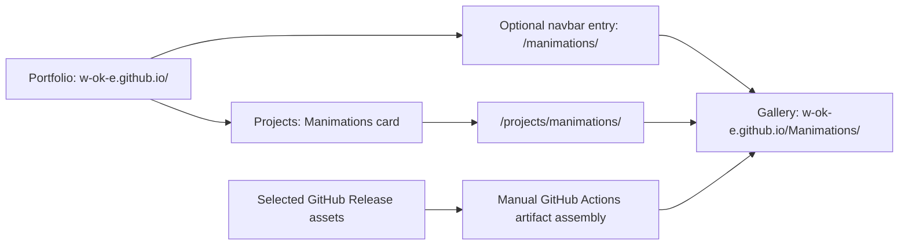

# Manimations

Mathematical animations made with Manim Community Edition, with a separate lightweight static video gallery.

Work happens on `gallery/start`. See [TODO.md](TODO.md) for progress. Each animation starts with `animations/<slug>/DESIGN.md`; om reviews its maths and storyboard before scene code or rendering. Preview feedback comes before a final render.

**Returning tomorrow?** Start with [Add another video](#add-another-video) and
[Dependencies](#dependencies-by-task). Adding an already-made video changes JSON
and media assets; it does not require editing the gallery HTML, CSS or JavaScript.

## Add another video

Run the commands below from this repository:

```sh
cd /home/w-ok-e/Github_Site/portfolio-demos/Manimations
```

There are two different jobs: **make a video**, and **put an existing video in
the gallery**. These steps cover the second job. If your MP4 already exists,
you do not need Manim installed to add it.

1. **Choose a permanent name for the video.** This is its `slug`, used in file
   names and the link after `#`. Use lowercase letters/numbers separated by
   hyphens, such as `my-next-video`. Give every video a different slug. Keep a
   published slug unchanged so old links continue working.

2. **Add one object to `animations/catalog.json`.** This file is a JSON array.
   Keep the existing entries, put a comma between objects, and do not put a comma
   after the final object. Add the following object, replacing its values:

   ```json
   {
     "slug": "my-next-video",
     "title": "My next animation",
     "tags": ["Computer science"],
     "description": "A plain-language explanation of what this video shows."
   }
   ```

   The title appears above the description. Tags appear in the topic filter
   automatically. The array order is the card order. You do not write HTML for
   the new card or add a new filter option by hand. Check the JSON syntax:

   ```sh
   python3 -m json.tool animations/catalog.json > /dev/null
   ```

3. **Export your existing MP4.** Replace the input path with your real video;
   keep quotes around paths with spaces. The slug must match step 2:

   ```sh
   python3 scripts/render.py my-next-video --input "/absolute/path/to/my-next-video.mp4"
   ```

   Keep the original input outside `docs/media/my-next-video.mp4`: that path is
   the exporter's output, and FFmpeg cannot use the same file as input/output.

   With `--input`, this command does **not** run Manim. It uses FFmpeg to prepare
   a browser-friendly H.264 MP4, at most 720p without enlarging smaller inputs,
   30 fps, with faststart. It also measures duration and makes a small WebP poster.
   It creates:

   ```text
   docs/media/my-next-video.mp4    the video
   docs/media/my-next-video.webp   the poster
   docs/media/my-next-video.json   generated duration and media paths
   ```

   It then regenerates `docs/animations.json` and the files under `docs/catalog/`.
   These are browser files; do not maintain them by hand. No website code changes
   are needed. Other cards are included when their exported metadata/assets are
   present in the same `docs/media/` folder. The command prints the media sizes.

   Current setup note: the Huffman export was prepared separately for review.
   If you want it in the normal local `docs/` gallery alongside your new clip,
   import it once using:

   ```sh
   python3 scripts/render.py huffman --input build/huffman/videos/scene/480p15/HuffmanEncoding.mp4
   ```

   Regeneration uses the source catalog and overwrites generated JSON, including
   any old edits made directly to those files during our earlier exercises.
   It does not re-encode other existing videos.

4. **Test locally.** Start a static web server:

   ```sh
   python3 -m http.server 8765 --bind 127.0.0.1 --directory docs
   ```

   Open `http://127.0.0.1:8765/#my-next-video` in your browser. Check the title,
   description, poster, playback, pause and topic filter. Refresh after changing
   generated files; if an old version remains, use the browser's hard reload or
   disable caching in its developer tools. Use Ctrl+C in the terminal to stop
   the server. Opening index.html as a `file://` URL is not a reliable test.

   Only the first 12 cards load initially. Use “Load more” for later cards, or
   open the new video's `#slug` directly. A clip can be below the fold: autoplay
   starts when its player area is visible, subject to browser/preferences.

5. **If you only change the title, tags or description later**, edit
   `animations/catalog.json` and regenerate the browser files:

   ```sh
   python3 scripts/catalog.py
   ```

   Do not rerender the animation or re-export the MP4 for a text-only change.
   If the video itself changes, repeat the export in step 3. If you supply a
   different poster manually, replace `docs/media/my-next-video.webp` and retain
   the same path; target 15 KB or smaller and the same 16:9 presentation.

6. **Publish only after the one-time hosting/storage setup is agreed and done.**
   As of this handoff, Pages for this repo is disabled, and
   `integration/pages.json` intentionally has no release tag or approved clips.
   Therefore local additions do not automatically become public. The proposed
   GitHub Releases → Pages workflow is prepared, not yet activated. If we choose
   git-based binary storage instead, we will adapt that one-time setup first.

   After choosing the prepared Release-based setup, each new video needs only:

   - Add its slug to `approved_slugs` in `integration/pages.json`, keeping previous
     slugs you still want to publish. No workflow-code edit is needed.
   - Upload the new `.mp4`, `.webp` and `.json` generated in step 3 to the GitHub
     Release named by `release_tag`. This can be done in GitHub's browser UI.
     File names must match the slug. The configured release must contain assets
     for **every approved slug**, not just the newest one. If you choose a new
     release tag, copy/upload the previously approved assets there too.
   - Review, commit and push the JSON/source changes through the working branch,
     then merge to `main`. For routine metadata-only additions, the files to
     review are `animations/catalog.json` and `integration/pages.json`.
     Do not force-add ignored videos to git under this Release-based approach.
   - On GitHub, open this repo's **Actions → Publish reviewed animation gallery
     → Run workflow**, choosing `main`. It downloads the selected media, makes
     fresh manifests and publishes the static artifact. It does not run Manim.
   - Check `https://w-ok-e.github.io/Manimations/#my-next-video` after deployment
     succeeds. The portfolio link/navbar needs no change for individual videos.

   These are instructions for a future authorized publication; no upload, push,
   Pages enablement or deployment was performed while writing this guide.

If you prefer to prepare the assets completely by hand, provide the MP4, WebP
and media JSON with the same names. The generated media JSON must include the
same slug, a positive duration in seconds, `video: "media/my-next-video.mp4"`
and `poster: "media/my-next-video.webp"`. Then run `python3 scripts/catalog.py`.
The exporter is recommended because it avoids guessing duration/paths/encoding.

For clarity, a minimal hand-written `docs/media/my-next-video.json` looks like
this (replace `12.4` with the actual duration in seconds):

```json
{
  "slug": "my-next-video",
  "duration": 12.4,
  "video": "media/my-next-video.mp4",
  "poster": "media/my-next-video.webp"
}
```

## Dependencies by task

| What you want to do | Install/use |
| --- | --- |
| Watch the published gallery | A modern browser. No Python, Manim or npm. |
| Serve the existing files locally | Python 3 for `python3 -m http.server`; no Python packages. |
| Add/import an existing MP4 | Python 3.10+ and system `ffmpeg` + `ffprobe`; no Manim, uv, Ruby or npm required. |
| Generate a new Manim animation | Project Python 3.10.12, uv, locked `.venv` with Manim CE 0.19.0, Cairo/Pango build dependencies and fonts. LaTeX/dvisvgm for scenes using Tex/MathTex. |
| Publish through the prepared workflow | GitHub account/repository access, one-time Pages configuration, selected GitHub Release media and JSON config. GitHub hosts the runner and the gallery. No running server to maintain. |
| Run automated browser QA | Node.js + Playwright 1.56.1 and system Chrome; QA only, not gallery runtime. |
| Build the separate main portfolio | Its own Jekyll/Ruby dependencies (CI uses Ruby 3.3), or its documented Docker setup. None of those are needed by the standalone gallery. |

**On this machine:** Python, FFmpeg/ffprobe, uv, the locked Manim environment,
Cairo/Pango, fonts, LaTeX/dvisvgm and Chrome are already present. No further
runtime dependencies are needed to browse, import another MP4, or render here.
Temporary QA npm packages live under `/tmp` and may need reinstalling later.
The separate portfolio's complete locked Ruby/Docker environment is still not
installed; focused template tests pass, but its full build remains pending.

For a fresh Ubuntu/Debian machine, importing an existing MP4 only needs:

```sh
sudo apt-get update
sudo apt-get install python3 ffmpeg
python3 --version
ffmpeg -version
ffprobe -version
```

Rendering new scenes additionally needs native packages such as:

```sh
sudo apt-get install curl python3-venv python3-dev build-essential pkg-config libcairo2-dev libpango1.0-dev fonts-dejavu-core texlive-latex-extra texlive-fonts-recommended texlive-science dvisvgm
```

Install uv if it is missing, following its [official installation instructions](https://docs.astral.sh/uv/getting-started/installation/).
For the version used here, its standalone Linux installer is:

```sh
curl -LsSf https://astral.sh/uv/0.8.15/install.sh | sh
```

Open a new terminal if `uv` is not yet on PATH, then use the locked environment
command in the next section. The installer above is only a documented option;
it was not run as part of testing. This repo requires Python 3.10; on this machine `/usr/bin/python3` is
3.10.12. On another machine supply a Python 3.10 interpreter rather than
assuming the system's default Python is compatible. The native install commands
above are documentation, not commands run automatically by the gallery.

If another machine has no Python 3.10, uv can install the pinned interpreter
before creating the environment:

```sh
UV_CACHE_DIR=.cache/uv uv python install 3.10.12
UV_CACHE_DIR=.cache/uv uv sync --locked --python 3.10.12
```

## Handoff test results — 2026-11-22

The “tomorrow, add a second video” workflow was exercised in an isolated ignored
copy, using ordinary system Python and FFmpeg, without importing Manim. JSON plus
assets added a second card; hashes confirmed the website HTML/CSS/JS and first
MP4 were unchanged. A later title-only change regenerated JSON without changing
either video. Chrome then verified the second card, updated title, automatic new
tag/filter and `#second-sample` playback. Fake entries never entered the real catalog.

That test exposed a generic playback bug: two equally visible cards could cause
a deep link to the second card to autoplay the first. The shared player now
prefers the linked/manually selected visible card. This was a one-time bug fix,
not additional programming required for individual videos. The addition test
and the full existing browser suite passed again after the fix.

Fresh checks also passed for 12-card paging, loaded-topic filtering, deep links
past the first page, desktop/mobile autoplay, native pause/toggle, keyboard play,
reduced-motion no-video-fetch, blocked-autoplay fallback, retry after a manifest
failure, no horizontal overflow and no JavaScript errors. Initial HTML/CSS/JS/JSON
was 17,211 bytes for 5 entries and 19,166 bytes for both 100 and 1000 entries,
excluding media. Lighthouse was not rerun in this handoff; earlier scores below
are dated historical measurements, not new scores for the updated player.

The real staged Huffman gallery passed at `/Manimations/#huffman` with same-origin
assets and muted playback; its exported MP4 decoded fully without errors.
Focused Liquid/Markdown checks passed against the actual portfolio header with
nav on/off, root/subpath, the project About link and your chosen lowercase
`/manimations/` landing route. Corrected its gallery target to uppercase
`/Manimations/`. Full Jekyll build/live Pages deployment remain unverified.

To inspect the currently tested Huffman gallery locally:

```sh
python3 -m http.server 8765 --bind 127.0.0.1 --directory build/handoff-gallery
```

Open `http://127.0.0.1:8765/Manimations/#huffman`. This serves the tested local
artifact; it does not enable GitHub Pages. Use Ctrl+C to stop it.

To repeat the focused next-day addition test (Chrome and temporary Playwright
installation required; no gallery runtime npm dependency):

```sh
npm install --prefix /tmp/manimations-qa --no-audit --no-fund playwright@1.56.1
python3 integration/check_add_video.py
node integration/check_add_video.cjs
```

The browser test starts/stops its own loopback server on port 8768. Reports and
screenshots stay under ignored `build/add-video-qa/`; general gallery QA stays
under `build/gallery-qa/`, and portfolio fixtures under `build/integration/`.

## Local environment

New work uses Python 3.10.12 and Manim CE 0.19.0 in an isolated `.venv`, with transitive dependencies recorded in `uv.lock`. This is an explicit version choice compatible with this machine's Python, not a claim to use the newest Manim release.

```sh
UV_CACHE_DIR=.cache/uv uv sync --locked --python /usr/bin/python3
UV_CACHE_DIR=.cache/uv uv run --locked manim --version
```

Native dependencies include Cairo, Pango, FFmpeg/ffprobe, LaTeX and dvisvgm. The approved hello-world preview rendered successfully; its command and verification report are in [DESIGN.md](animations/hello-world/DESIGN.md#preview-result-2026-11-20). Native libraries and system fonts are not pinned by the Python lockfile, so byte-identical output across machines is not guaranteed.

## Layout

- `animations/<slug>/DESIGN.md`: claim, checked maths, proposed choices, storyboard, sources and review questions; `scene.py` follows approval.
- `docs/`: standalone GitHub Pages gallery; `docs/media/` contains generated MP4s and WebP posters.
- `animations/catalog.json`: source list of titles, slugs, tags and text descriptions, separate from scene code and media.
- `scripts/catalog.py`: generates bounded manifest pages and per-slug deep-link records.
- `scripts/render.py`: renders a reviewed scene or imports an existing clip, then exports delivery media and updates the manifests.
- `TTC_ML/`: preserved legacy project, separate from the new environment. Its dependency export includes ROS packages and machine-specific paths; do not install it for new work.

Generated environments, caches and new media are ignored. Hosting and large-file storage require om's approval. LICENSE is unchanged. Nothing is published automatically.

## Huffman inspection preview

om authorized completing a 480p preview before further questions on 2026-11-22.
See [the completed preview design](animations/huffman/DESIGN.md) for exact maths,
sources, storyboard and provisional visual choices; the earlier discussion is
preserved in `animations/huffman/DESIGN_DISCUSSION.md`.

```sh
python3 animations/huffman/prepare_preview.py
UV_CACHE_DIR=.cache/uv uv run --locked manim -ql --renderer cairo --media_dir build/huffman --disable_caching --progress_bar none animations/huffman/scene.py HuffmanEncoding
.venv/bin/python scripts/inspect_huffman_preview.py
```

The MP4 is `build/huffman/videos/scene/480p15/HuffmanEncoding.mp4`. Computed
inputs/results live in `animations/huffman/preview_results.json`; ignored
`build/huffman/` contains actual packed examples, shot timestamps, decoded-frame
samples and the inspection report. The longer input is an original constructed
English sample intentionally rich in e/spaces, labelled on screen. Both inputs
are decoded from their serialized-tree/byte-packed representations during
verification. A final render and gallery integration await om's preview feedback.

## Preview the gallery

The accepted hello-world clip is reused as an explicitly labelled playback placeholder.
From the repository root, generate its ignored media (using the existing preview):

```sh
.venv/bin/python scripts/render.py playback-test --input build/hello-world/videos/scene/480p15/HelloWorld.mp4
python3 -m http.server 8765 --bind 127.0.0.1 --directory docs
```

Open `http://127.0.0.1:8765/`. If the original hello-world preview is missing, reproduce it using the command in its DESIGN.md first. The gallery runs without Manim, Python packages, npm, external fonts or a build step; Python above only serves static files locally. Its relative paths also work at `/Manimations/` on GitHub Pages. Opening index.html directly with a file URL will not work reliably because browsers restrict JSON fetches there.

On 2026-11-21 om requested autoplay, replacing the original click-only loading requirement. One visible clip plays automatically, muted and inline; offscreen playback pauses, and browser rejection leaves a Play button. Native controls and an autoplay toggle allow pausing and enabling sound. Reduced-motion and data-saving preferences disable autoplay by default; explicit manual playback remains available. No automatic looping. Browser policies may still prevent autoplay: see the [MDN autoplay guide](https://developer.mozilla.org/en-US/docs/Web/Media/Guides/Autoplay) and [play() rejection handling](https://developer.mozilla.org/en-US/docs/Web/API/HTMLMediaElement/play), checked 2026-11-21.

The initial `animations.json` contains at most 12 entries and the next page's path. Load more fetches another page; it does not fetch the full catalog on startup. Topic filtering explicitly applies to loaded animations. Deep links such as `#playback-test` fetch one per-slug record if needed. Initial metadata/markup cost is bounded by one page; autoplay adds actual visible-video traffic, so total first-load bytes depend on the chosen clip, screen size and browser. Loading a growing list is not a constant-size full-catalog operation.

## Add an approved animation

1. Complete the design/review/preview protocol with om.
2. Add its title, slug, tags and description to `animations/catalog.json`.
3. Export an approved existing MP4 with `.venv/bin/python scripts/render.py <slug> --input <path>`; or, after final-render approval, render `animations/<slug>/scene.py` with `.venv/bin/python scripts/render.py <slug> --scene-class <ClassName>`.

The exporter writes `docs/media/<slug>.mp4`, a WebP poster and generated metadata, then updates manifest pages. Delivery uses H.264/yuv420p, at most 1280×720 without upscaling, 30 fps, CRF 24 and faststart. Posters are 640 pixels wide with quality adjusted toward a 15 KB target. Files are measured and sizes printed. The placeholder export is 11,584 bytes for MP4 and 1,856 bytes for its poster. These media files remain ignored pending om's storage/commit decision. Source generation does not remove stale catalog records; any removal requires review.

## Gallery verification

`scripts/gallery_fixtures.py` generates temporary 1/5/100/1000-entry galleries in ignored `build/gallery-qa/`, all reusing the approved test clip. It verifies the HTML/CSS/JS/first-JSON budget stays under 50 KB, and the 100/1000-entry initial sizes are identical. No fake entries enter the real gallery or git.

Browser QA uses temporary tooling under `/tmp`, with no gallery runtime dependencies:

```sh
npm install --prefix /tmp/manimations-qa playwright@1.56.1 lighthouse@12.8.2
python3 scripts/gallery_fixtures.py
python3 -m http.server 8766 --bind 127.0.0.1 --directory build/gallery-qa
# In a second terminal (system Chrome at /usr/bin/google-chrome):
node scripts/check_gallery.cjs
```

The browser script checks autoplay without scrolling at desktop/mobile test sizes, muted inline playback, native pause, toggle, paged loading, topic filtering, subpath deep links, reduced-motion no-video-fetch behavior, keyboard play, blocked-autoplay fallback and manifest retry. Reports and screenshots remain under `build/gallery-qa/`. Lighthouse reports are local mobile simulations using the small placeholder; future real videos should be audited again because their bandwidth/decoding costs will differ. No publication is part of these checks.

Verified 2026-11-21: browser checks pass. Mobile Lighthouse performance/accessibility scores were 100/100 with 5 entries and 99/100 with 100 entries. Uncompressed initial HTML/CSS/JS/JSON was 16,015 bytes for the real placeholder gallery, 17,029 bytes for 5 temporary entries, and 18,984 bytes for both 100 and 1000 temporary entries; media bytes are additional.

## Connect to the portfolio — collaborative GitHub-only setup

Prepared locally on 2026-11-22. This repo remains on `gallery/start`; the
portfolio checkout at `/home/w-ok-e/Github_Site/W-OK-E.github.io` is on the new
`gallery/manimations-link` branch. Only four new portfolio files were added;
the shared header and existing work were not edited. Nothing was pushed,
uploaded to a release, or enabled in Pages.



The portfolio's existing Jekyll header reads each page's `nav` and `nav_order`.
The new landing page and project page share one gallery-link include. This keeps
the project discoverable when the optional navbar entry is hidden. The gallery
is a separate Pages project site; its HTML, CSS, JS, JSON, posters and MP4s are
served together from `/Manimations/`, without a server or an external video host.
The homepage's current deployment still builds Jekyll from main into its own
`gh-pages` branch; we do not replace that workflow.

Your pieces are intentionally marked `TODO(om)`:

1. **URL routing:** fill the actual portfolio's `_data/manimations.yml`
   `gallery_path`. Hint: your current `/manimations/` is the portfolio landing page, while the
   other repository's Pages path follows its repository name, including both
   slashes. Blank safely shows “coming soon” rather than a broken button.
2. **Navbar choice:** in the portfolio's `_pages/animations.md`, set the real
   YAML boolean `nav` to `true` or `false`; optionally choose `nav_order`.
   The default is false while you decide. No shared-header edit is needed.
3. **Published clips and storage:** in this repo's `integration/pages.json`,
   choose the reviewed slugs and a release tag after we agree on media storage.
   The proposed workflow uses GitHub Releases as the binary store, keeping MP4s
   out of source history. Git-tracked media is an alternative we can wire in;
   that storage decision is yours. Empty choices deliberately stop deployment.

Initial scaffolds are kept in `integration/portfolio/` for review. The actual
installed files in the portfolio are where you should make the URL/nav edits.
`integration/apply_portfolio.py` installs only new files and refuses overwrites;
do not rerun it after those files already exist.

Current routing after your edits: the landing page is lowercase `/manimations/`
(title “Manimations”, `nav: true`); the gallery is uppercase `/Manimations/`,
matching the separate repository name. The gallery button must point to the
uppercase path, or it would link back to the landing page. Both that target
and the project's “About the collection” link have been checked against your
chosen routes; your title, description and navbar choice are preserved.

The accepted 480p Huffman preview was exported into a separate review directory,
preserving the working docs/ manifests and your earlier exercise edits:

```sh
.venv/bin/python scripts/render.py huffman --input build/huffman/videos/scene/480p15/HuffmanEncoding.mp4 --output-dir build/github-pages-media-review
```

The generated release-candidate assets are:

| Asset | Bytes |
| --- | ---: |
| `build/github-pages-media-review/media/huffman.mp4` | 1,382,690 |
| `build/github-pages-media-review/media/huffman.webp` | 7,784 |
| `build/github-pages-media-review/media/huffman.json` | 389 |

This is an export of the existing clip to 30 fps/faststart, preserving 480p;
it is not a new final-quality Manim render. Files stay ignored, uncommitted and
unpublished. Description/title metadata can be edited in animations/catalog.json.

`.github/workflows/gallery-pages.yml` is manual-only and restricts deployment
to main. It validates your config, downloads only the selected `.mp4`, `.webp`
and `.json` from this repository's release, builds fresh static output under
`build/pages`, uploads that artifact, and deploys it to Pages. It runs no Manim
or website framework build. `scripts/stage_pages.py` regenerates manifests from
the selected assets, so placeholder clips, stale generated entries, scene code,
notes and QA fixtures cannot accidentally enter the artifact. It refuses reuse
of a nonempty destination. Release assets are copied into Pages rather than
streamed directly from release-download URLs.

Checks completed:

- `ruby integration/check_portfolio.rb /home/w-ok-e/Github_Site/W-OK-E.github.io`
  exercises the actual Liquid header with nav on/off, root/subpath base URLs,
  project links independent of the navbar, and the blank URL state.
- `python3 integration/check_staging.py` verifies the test-only selected Huffman
  artifact and the deliberate unconfigured deployment gate. The test config
  under build/ is not approval to publish and does not alter your real choices.
- Browser QA at `/Manimations/#huffman`: all assets served from the same local
  origin, selected clip only, muted autoplay, no JavaScript errors. Local artifact
  is 1,407,293 bytes. Workflow YAML/manual trigger/artifact path also checked.
- Full portfolio Jekyll/Docker build was not run: locked gems are missing locally
  (system Ruby 3.0.2; existing CI uses 3.3) and its Docker image is not installed.
  Focused Liquid checks are not a substitute. Complete its normal build/preview
  before pushing the portfolio branch.

Read-only GitHub checks confirm the public Manimations repo uses main and has
Pages **disabled**. The existing portfolio is built at https://w-ok-e.github.io/
from `gh-pages:/`. Authentication works. No settings were changed.

After your edits and explicit publication approval: review/commit/push the two
branches, merge the gallery source to main, create/upload the agreed release
assets, set **only Manimations** Settings → Pages → Source to **GitHub Actions**,
and run “Publish reviewed animation gallery” manually. Verify the live gallery
before publishing the portfolio link. The main portfolio keeps its existing
Pages configuration. These remain future steps, not actions performed here.

References checked 2026-11-22: [GitHub Pages publishing sources](https://docs.github.com/en/pages/getting-started-with-github-pages/configuring-a-publishing-source-for-your-github-pages-site),
[official static Pages workflow](https://github.com/actions/starter-workflows/blob/main/pages/static.yml),
[release-download CLI](https://cli.github.com/manual/gh_release_download),
and [Pages limits](https://docs.github.com/en/pages/getting-started-with-github-pages/github-pages-limits).
The lightweight initial page payload stays bounded; hosted content and video
bandwidth still count against GitHub's published limits.
